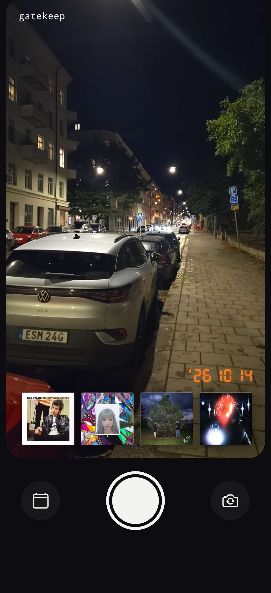
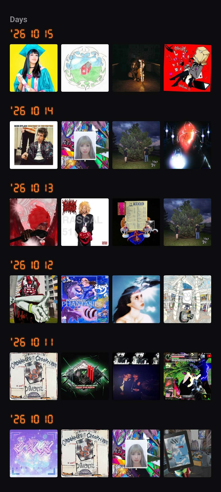
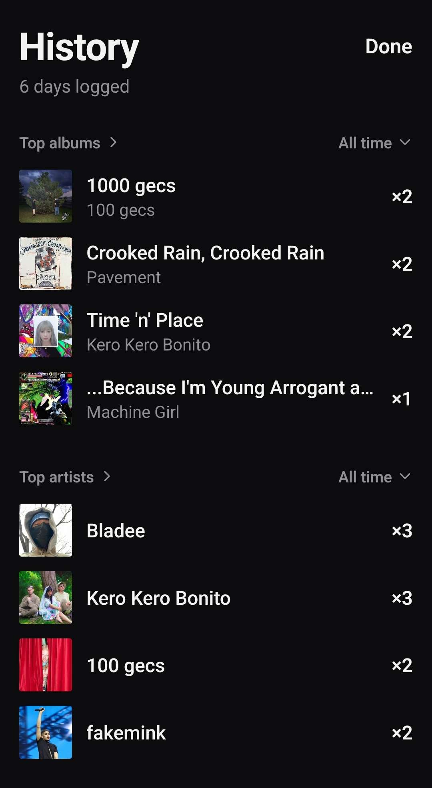

<div align="center">

# Gatekeep

**A daily music journal. Snap a photo, pick four albums that sum up your day, share it as one image.**

[](https://github.com/ColdVisionzz/Gatekeep/actions/workflows/android-apk.yml)


[](LICENSE)

<br />


&nbsp;&nbsp;

&nbsp;&nbsp;


<sub>Capture &nbsp;·&nbsp; Days &nbsp;·&nbsp; Statistics</sub>

</div>

## Overview

Gatekeep turns "what was I listening to?" into a one-minute daily ritual. Take the day's photo, choose four albums, and the app composes a 1080×1920 recap with a retro LED date stamp, ready for any story or feed. Every recap is also logged on the device, so over time you get a personal listening history: top albums and artists, a year calendar, and a page for every album and artist you have picked.

There are no accounts, no backend and no tracking. Everything lives on your phone.

## Availability

| Platform | Status |
| --- | --- |
| **Android** | Released. Download the APK from [Releases](../../releases). |
| **iOS** | Not published. The codebase is cross-platform and can be built for iOS from source (see [Build from source](#build-from-source)). |

### Install (Android)

Download the latest `.apk` from [Releases](../../releases), open it, and allow installs from your browser or file manager when Android asks. Play Protect may warn because the APK is signed with a debug key, not a Play Store key. To update, install the newer APK over the old one.

## Features

**Capture**
- Full-screen 9:16 camera viewfinder with your four albums and the date overlaid live, so you compose the shot as the final image will look.
- Front and back camera switch, and a haptic pulse on capture in place of the system shutter sound.
- LED-style date stamp, rendered the same on screen and in the export.

**Pick albums**
- Album search on the public Deezer API: debounced input, in-flight request cancellation, and clear searching, empty and offline-retry states.
- Four slots, tap any one to fill or replace it. Failed cover loads are retried when you re-pick.

**Daily habit**
- One gatekeep per day.
- A 19:00 reminder with rotating prompts, rescheduled on every launch for the next 14 days and skipped on days you have already done. The notification permission is requested after your first recap, not on first launch.

**Export and share**
- 1080×1920 PNG export, saved to a dedicated "Gatekeep" album in your photos and opened in the system share sheet.
- After you submit, the app opens your album statistics.

**History and statistics**
- Day list, newest first, four covers per day.
- Year calendar in the style of a contribution graph, with tap-through to any logged day.
- Top albums and top artists with ×count, over a selectable range: all time, 7, 14, 30, 90, 180 or 360 days. Tap a header for the full ranking.
- Album page: calendar of days picked, dates, and the albums it is most often paired with.
- Artist page: picked days, top albums, and pairings.

## Tech stack

| Area | Choice |
| --- | --- |
| Framework | Expo SDK 57, React Native 0.86, React 19 |
| Language | TypeScript (strict) |
| Camera | `expo-camera` |
| Image export | `react-native-view-shot` |
| Gallery and sharing | `expo-media-library`, `expo-sharing` |
| Images | `expo-image` |
| Storage | JSON file via `expo-file-system` |
| Reminders | `expo-notifications` |
| Data | [Deezer API](https://developers.deezer.com/api) (search, covers, artist pictures) |
| CI | GitHub Actions builds the release APK |

## Architecture

- **Single screen plus modals, by design.** `App.tsx` is the whole app shell; search and history open as modals. No router is needed until there is real multi-screen navigation.
- **Pure logic split from I/O.** `albums.ts` and `history.ts` (parsing, day keys, statistics) are free of React Native imports, so they run under plain Node tests. File access is isolated in `historyStore.ts`.
- **Defensive persistence.** History is a single `history.json`. A corrupt file is renamed aside rather than crashing the app or being overwritten.
- **Continuous Native Generation.** `ios/` and `android/` are not committed. They are generated from `app.json` and config plugins.
- **Privacy by construction.** No backend exists to leak anything. The only network traffic is Deezer.

## Privacy

Gatekeep has no accounts and no backend. History is saved in a JSON file on the device. The app asks for the camera (your daily photo), photo library access (to save each recap to its own album) and notifications (the daily reminder). The only network requests go to Deezer, to search albums and load album covers and artist pictures.

## Build from source

The app uses native modules that are not part of Expo Go (for example `react-native-view-shot`), so run it in a development build.

```sh
npm install
npx expo run:android   # needs Android Studio / SDK
npx expo run:ios       # needs macOS and Xcode
```

To build in the cloud without local toolchains, use [EAS Build](https://docs.expo.dev/build/introduction/). Shipping to iOS devices needs an Apple Developer account for signing. No iOS release is published.

### Release pipeline

A GitHub Actions workflow (`.github/workflows/android-apk.yml`) regenerates the native project, builds a release APK on every push to `main`, and attaches it to a GitHub Release when a `v*` tag is pushed. The APK is signed with a debug keystore, which is fine for sideloading but not for the Play Store.

## Checks

```sh
npx tsc --noEmit
npm run lint
npx tsx albums.test.ts
npx tsx history.test.ts
```

## Project structure

| File | Purpose |
| --- | --- |
| `App.tsx` | Main screen: camera, album slots and export |
| `AlbumSearch.tsx` | Album search modal |
| `History.tsx` | Past days and statistics |
| `TopList.tsx` | Full album or artist ranking |
| `ArtistPage.tsx` | One artist: picked days, top albums and pairings |
| `AlbumPage.tsx` | One album: picked-days calendar, dates and most common pairings |
| `DateStamp.tsx` | LED-style date display |
| `DaysSection.tsx` | Year calendar and day list |
| `RangePicker.tsx` | Date range selector for statistics |
| `StatRows.tsx` | Album and artist ranking rows |
| `notifications.ts` | Daily reminder scheduling |
| `albums.ts` | `Album` type and Deezer search |
| `history.ts` | History parsing and statistics |
| `historyStore.ts` | Reads and writes `history.json` on the device |
| `theme.ts` | Color tokens |
| `docs/screenshots/` | README images |

## Contributing

Issues and pull requests are welcome. Run the checks above before you open a pull request.

## Acknowledgements

Album data and cover art come from the [Deezer API](https://developers.deezer.com/api). Gatekeep is not affiliated with Deezer. Cover art belongs to its rights holders.

## License

Released under the [MIT License](LICENSE).
